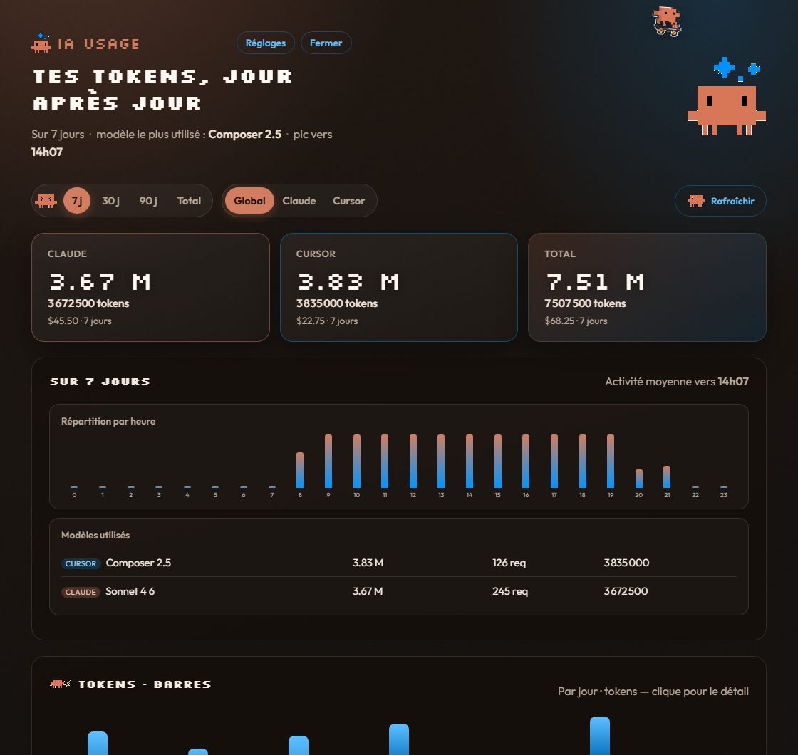

# IA Usage

**See your Claude Code and Cursor token history in one Windows dashboard.** A small desktop widget follows the active Cursor or Claude window. Click it to open your charts and model breakdown.



*Dashboard shown with sample data.*

## Install on Windows

Download the preview installer from [GitHub Releases](https://github.com/ewan147/IA-Usage/releases) for Windows builds. To build from source, install [Node.js 24 LTS](https://nodejs.org/) and the [Windows prerequisites for Tauri](https://v2.tauri.app/start/prerequisites/#windows), then run:

```powershell
git clone https://github.com/ewan147/IA-Usage.git
cd IA-Usage
npm ci
npm run tauri build
```

The Windows app enables startup for the current user when launched in a release build. The optional `scripts/setup.ps1` script also creates a desktop shortcut and opens the app.

## What the numbers mean

| Source | Data |
| --- | --- |
| **Claude Code** | Local session logs. Streaming updates for the same call are deduplicated. USD figures use estimated API prices. |
| **Cursor** | Usage events from the dashboard CSV. Totals include cache tokens and group events by local date. |

The dashboard reads local Claude Code logs. Cursor sync connects to cursor.com and keeps the latest imported export and totals on your PC. If automatic sync fails, open **Données Cursor** in IA Usage, export the desired date range from the Cursor dashboard, then select the CSV. Each manual import replaces the displayed Cursor history and pauses automatic sync. A successful **Synchroniser avec Cursor** starts it again. Cursor's newer plans can share a weekly allowance with Grok. IA Usage displays event totals for all rows in the export. If the export includes Grok Bot, filter to Cursor in the dashboard before exporting. The app does not show your remaining allowance. [Cursor usage limits](https://cursor.com/help/models-and-usage/usage-limits)

Found a mismatch? [Open an issue](https://github.com/ewan147/IA-Usage/issues/new) with your Windows version, Cursor plan type and CSV column names. Keep account details, session data and private logs out of public reports. If the widget saves you a trip to the usage dashboard, a star helps other Windows users find it.

## En français

IA Usage rassemble l’historique des tokens Claude Code et Cursor dans un tableau de bord Windows. Clique sur la mascotte près de la fenêtre active pour l’afficher. Les coûts Claude Code sont estimés d’après des tarifs API. Pour Cursor, l’application affiche les événements disponibles dans l’export du compte. Le quota hebdomadaire restant est consultable dans Cursor.

Build de développement : `npm ci`, puis `npm run tauri dev`.
